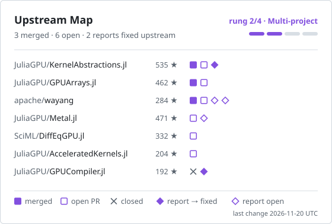

# Sasmith A Suvarna

Systems and backend engineering student at ABV-IIITM Gwalior.
I fix bugs upstream in the Julia GPU stack and Apache Wayang, and build backend systems: hybrid search, reliable action execution.

<!-- upstream:start -->
<picture>
  <source media="(prefers-color-scheme: dark)" srcset="assets/upstream-map-dark.svg">
  
</picture>

## Upstream work

**3 PRs merged into 3 projects** · 6 open (1 in review) · 2 reports fixed upstream · [rung 2 of 4](UPSTREAM_MAP.md)

**[KernelAbstractions.jl](https://github.com/JuliaGPU/KernelAbstractions.jl)** · JuliaGPU · 535 ★

- **merged** 2026-11-07 · [#948](https://github.com/JuliaGPU/KernelAbstractions.jl/pull/948) Add `get_backend` for `Memory`
- **open** · 3 reviews · [#957](https://github.com/JuliaGPU/KernelAbstractions.jl/pull/957) Accept `Memory` as a kernel argument on the POCL backend
- **report → fixed** in [JuliaPackaging/Yggdrasil#15480](https://github.com/JuliaPackaging/Yggdrasil/pull/15480) · [#949](https://github.com/JuliaGPU/KernelAbstractions.jl/issues/949) BFloat16 tests fail on Apple M5 (ties not rounded to even)

**[GPUArrays.jl](https://github.com/JuliaGPU/GPUArrays.jl)** · JuliaGPU · 462 ★

- **merged** 2026-11-19 · [#849](https://github.com/JuliaGPU/GPUArrays.jl/pull/849) Copy from `BitArray`s to GPU arrays without scalar indexing
- **open** · awaiting review · [#862](https://github.com/JuliaGPU/GPUArrays.jl/pull/862) Implement `findmin!` and `findmax!` for GPU arrays

**[wayang](https://github.com/apache/wayang)** · apache · 284 ★

- **merged** 2026-11-12 · [#873](https://github.com/apache/wayang/pull/873) Remove stale TODO from FlinkReduceByOperatorTest #228
- **open** · awaiting review · [#885](https://github.com/apache/wayang/pull/885) Fix JavaReservoirSampleOperator returning the whole input when the dataset size is unknown
- **report** · open · [#895](https://github.com/apache/wayang/issues/895) DISCLAIMER and some "(incubating)" references are still around after graduation
- **report** · open · [#884](https://github.com/apache/wayang/issues/884) JavaReservoirSampleOperator returns the whole input when the dataset size is unknown

**[Metal.jl](https://github.com/JuliaGPU/Metal.jl)** · JuliaGPU · 471 ★

- **open** · awaiting review · [#1136](https://github.com/JuliaGPU/Metal.jl/pull/1136) Accept flushed subnormals in the BFloat16 conversion test
- **report** · open · [#1135](https://github.com/JuliaGPU/Metal.jl/issues/1135) BFloat16 conversion test fails on M5: subnormal `Float32` inputs flush to zero

**[DiffEqGPU.jl](https://github.com/SciML/DiffEqGPU.jl)** · SciML · 332 ★

- **open** · awaiting review · [#592](https://github.com/SciML/DiffEqGPU.jl/pull/592) Support `DynamicalODEFunction` and `SecondOrderODEProblem` in `EnsembleGPUArray`

**[AcceleratedKernels.jl](https://github.com/JuliaGPU/AcceleratedKernels.jl)** · JuliaGPU · 204 ★

- **open** · awaiting review · [#210](https://github.com/JuliaGPU/AcceleratedKernels.jl/pull/210) Run operations on BitArrays on the host, writing to them on one task

**[GPUCompiler.jl](https://github.com/JuliaGPU/GPUCompiler.jl)** · JuliaGPU · 192 ★

- **closed** · superseded by [#1094](https://github.com/JuliaGPU/GPUCompiler.jl/pull/1094) · [#1089](https://github.com/JuliaGPU/GPUCompiler.jl/pull/1089) Only lower calls to declared throw functions
- **report → fixed** in [#1094](https://github.com/JuliaGPU/GPUCompiler.jl/pull/1094) · [#1088](https://github.com/JuliaGPU/GPUCompiler.jl/issues/1088) `lower_throw!` treats any function whose name contains `jl_error` etc. as a throw (kernel becomes a trap / segfault)

Generated from the GitHub API by [scripts/upstream_map.py](scripts/upstream_map.py), refreshed daily. Counts only repositories I don't own. Last change 2026-11-20 UTC.
<!-- upstream:end -->

## Projects

- **[oneshot](https://github.com/sasmith-14/oneshot)**: reliable action execution for AI agents. Idempotency keys, leases, retries only when provably safe, crash recovery, and reconciliation against an independent ledger. Python, FastAPI, React console.
- **[gitgrep](https://github.com/sasmith-14/gitgrep)**: hybrid search over GitHub repositories. BM25 and MiniLM retrieval fused with Reciprocal Rank Fusion, with a labeled evaluation set and latency benchmarks. TypeScript, Python, Elasticsearch.
- **[pilot](https://github.com/sasmith-14/agent)**: a local AI agent with tool calling, per-tool allow/ask/deny permissions and JSONL run traces. Raw HTTP to Gemini or Ollama, no LLM SDKs. Python.
- **[krypt](https://github.com/sasmith-14/krypt)**: real-time messaging backend with JWT auth, rate limiting and input sanitisation. Node.js, Socket.io, MongoDB.

**How I work:** reproduce the bug in the smallest case I can, turn it into a failing test, then send the fix, or report it upstream when the fix belongs to a maintainer.
