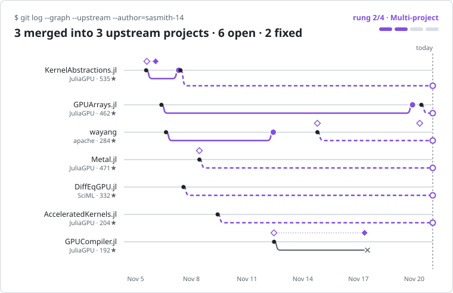
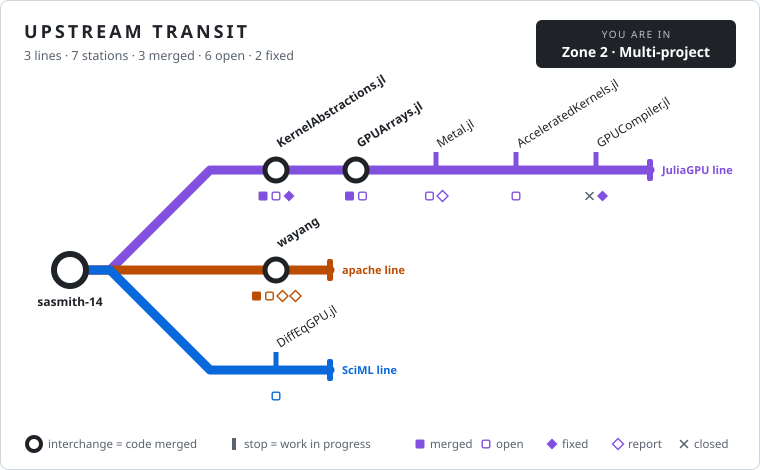
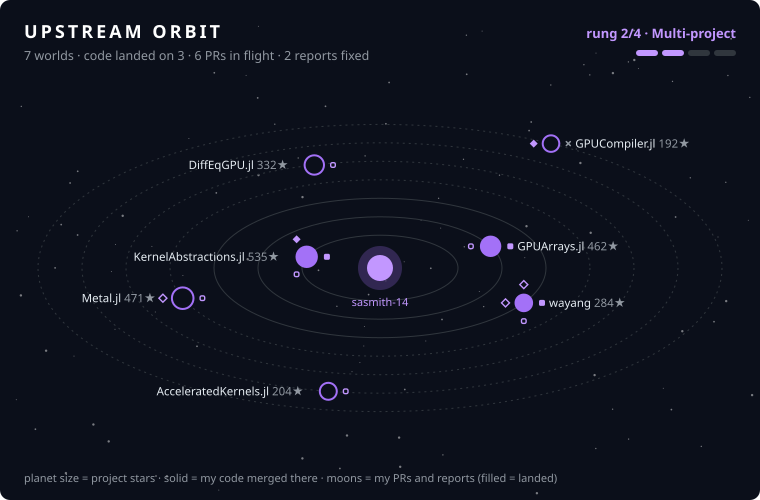
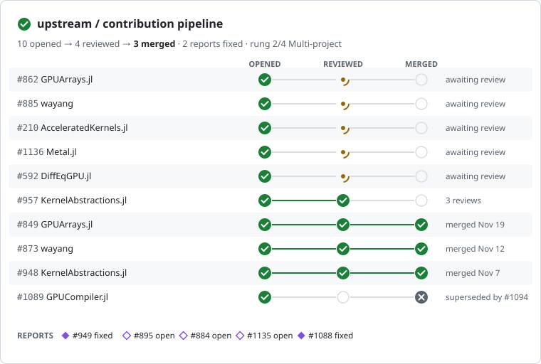

# Hi, I'm Sasmith 

Student at ABV-IIITM Gwalior, building backend systems and contributing to open source.

## What I'm working on
- **[OneShot](https://github.com/sasmith-14/oneshot)**: reliable action execution for AI agents: idempotency keys, leases, retries only when provably safe, crash recovery, and reconciliation against an independent provider ledger. Includes a self-checking demo of 12 failure scenarios and a React web console.
- **[gitgrep](https://github.com/sasmith-14/gitgrep)**: GitHub repo search engine combining BM25 and semantic (MiniLM) retrieval with Reciprocal Rank Fusion, with an evaluation set and latency benchmarks.
- **[Pilot](https://github.com/sasmith-14/agent)**: a local Python AI agent with tool calling, per-tool allow/ask/deny permissions, and JSONL run traces; uses raw HTTP, no LLM SDKs.
- **[Krypt](https://github.com/sasmith-14/krypt)**: real-time messaging backend (Node.js, Express, Socket.io, MongoDB) with JWT auth, bcrypt password hashing, rate limiting, and XSS / NoSQL-injection protection.
- Getting started with open-source contributions to backend and developer-tooling projects.

## Upstream contributions

<!-- upstream:start -->
<picture>
  <source media="(prefers-color-scheme: dark)" srcset="assets/gitgraph-dark.svg">
  
</picture>

More views: transit · orbit · pipeline

 

<picture>
  <source media="(prefers-color-scheme: dark)" srcset="assets/transit-dark.svg">
  
</picture>

<picture>
  <source media="(prefers-color-scheme: dark)" srcset="assets/pipeline-dark.svg">
  
</picture>

**Merged**

- [GPUArrays.jl #849](https://github.com/JuliaGPU/GPUArrays.jl/pull/849) Copy from `BitArray`s to GPU arrays without scalar indexing
- [wayang #873](https://github.com/apache/wayang/pull/873) Remove stale TODO from FlinkReduceByOperatorTest #228
- [KernelAbstractions.jl #948](https://github.com/JuliaGPU/KernelAbstractions.jl/pull/948) Add `get_backend` for `Memory`

Generated daily from the GitHub API by [scripts/upstream_map.py](scripts/upstream_map.py). Counts only repositories I don't own. [How this is measured](UPSTREAM_MAP.md).
<!-- upstream:end -->

## Tech I use
Python (FastAPI, Pydantic, pytest) · TypeScript / Node.js (Express) · React · Elasticsearch · MongoDB · SQLite · Docker · GitHub Actions 

